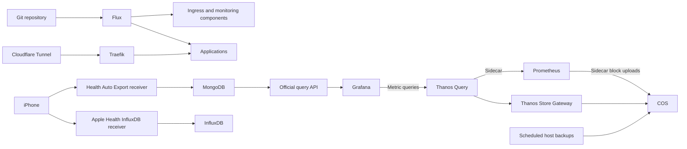

# CloudLab

A single-node k3s environment on Tencent Cloud CVM. Flux syncs Kubernetes configuration from Git, and SOPS/age encrypts credentials. Cloudflare Tunnel provides HTTPS access. COS stores application backups and long-term Prometheus metrics.

## Architecture



The official Health Auto Export dashboards query MongoDB through an HTTP API. InfluxDB provides a separate import and query path. See [Apple Health](docs/apple-health.md) for both import paths and their credentials, [monitoring](docs/monitoring.md) for Prometheus retention and Thanos queries, and [backups](docs/backups.md) for application backup and restore steps.

## Repository layout

| Directory | Contents |
| --- | --- |
| [infra/](infra/) | Cloud resources and cluster bootstrap. OpenTofu files are at this level; `bootstrap.sh` installs Flux; `flux/` defines sync entries, dependencies, and shared settings; `backup/` contains host backup and restore scripts and systemd units |
| [platform/](platform/) | Traefik, cloudflared, kube-prometheus-stack, and Thanos; Gateway API CRDs are in `traefik/crds/` |
| [apps/](apps/) | One directory per application, containing workloads, Services, PVCs, configuration, HTTPRoutes, and encrypted secrets. Health Auto Export's MongoDB is in that application's directory |
| [scripts/](scripts/) | Repository validation tools and regression tests in `tests/` |
| [docs/](docs/) | Guides for deployment, credentials, DNS, monitoring, Apple Health, and recovery |

Each component's `kustomization.yaml` lists its deployment resources. `source.yaml` defines the Helm repository, `resources.yaml` contains workloads or a HelmRelease, and `*.sops.yaml` and `*.example.yaml` contain encrypted credentials and examples. These files live directly in the component directory.

Flux syncs in the order `gateway-crds → platform → apps`. Gateway API CRDs must exist before Traefik and HTTPRoutes. Applications deploy after the platform is ready. The platform and apps sync entries each decrypt Secrets and read the domain from shared settings. `kube-prometheus-stack` deploys Prometheus, Alertmanager, Grafana, and metrics collectors, and manages Grafana's route, dashboards, and data sources.

`CLOUDLAB_DOMAIN` in `infra/flux/settings.yaml` is shared by OpenTofu, application HTTPRoutes, and Homepage. Public DNS records are managed in [dns-config](https://github.com/fullstackjam/dns-config).

## Deployment and maintenance

1. Follow the [bootstrap guide](docs/bootstrap.md) to prepare the host, cloud resources, credentials, and Git sync.
2. Use the [credentials guide](docs/secrets.md) to generate, encrypt, and recover credentials, and the [DNS guide](docs/dns.md) to configure domains and routes.
3. After changing application or platform configuration, run validation, push to the branch Flux watches, and verify the synced revision, workloads, and service behavior.
4. Before replacing a node or data disk, test recovery in an isolated environment using the [backup guide](docs/backups.md), then switch traffic.

The reference deployment uses Ubuntu 24.04 and single-node k3s. The data disk is mounted at `/data`, and local volumes are stored in `/data/k3s/storage`. Requested PVC sizes for local-path storage do not enforce disk quotas; see the monitoring guide for disk capacity and alerts. Node upgrades can interrupt service, so check version compatibility and recovery options first. Check Flux pruning and volume reclaim policies before deleting or moving PVCs.

## Validation

```bash
./scripts/validate.sh
```

[Validate CI](.github/workflows/validate.yml) scans for credentials and runs this script on pull requests and pushes to `main`. The script checks shell syntax, YAML, file references, and SOPS file rules; validates OpenTofu; renders all Kustomize entry points and Helm charts; validates resources against their CRD schemas; and runs Kuma export and Thanos alert rule tests.

Tool versions are OpenTofu 1.13.9, Kustomize 5.8.3, Helm 3.19.2, Flux 2.9.6, kubeconform 0.8.0, promtool 3.16.0, Python 3, and PyYAML. Credential operations use SOPS 3.13.3 and age 1.3.2. See the CI workflow for installation and checksum verification. Validation needs network access to download providers, charts, and schemas.

For directory changes, also compare rendered objects and Flux ownership before and after the change. Changes that affect deployment behavior need live service checks after static validation. See [AGENTS.md](AGENTS.md) for contributor instructions.

## License

[Apache-2.0](LICENSE). Third-party software and dashboards retain their own licenses.
