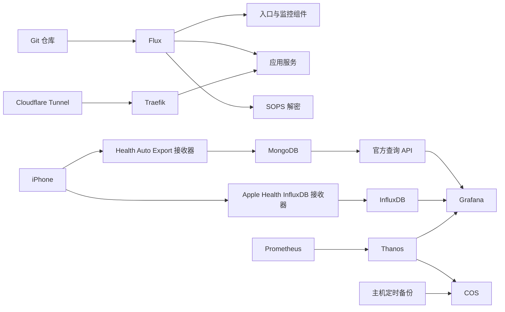

# CloudLab

在腾讯云 CVM 上运行的单节点 k3s 环境，通过 Flux 从 Git 同步 Kubernetes 配置，使用 SOPS/age 管理加密凭据。Cloudflare Tunnel 提供 HTTPS 入口，COS 保存应用备份和 Prometheus 长期指标。

## 架构



官方 Health Auto Export 面板通过 HTTP API 查询 MongoDB，另一个 Apple Health 面板查询 InfluxDB。两条导入链路和各自的凭据见 [Apple Health 接入](docs/apple-health.md)。Prometheus 的本地留存、Thanos 查询和长期保存配置见 [监控手册](docs/monitoring.md)，应用数据的备份与恢复见 [备份手册](docs/backups.md)。

## 目录职责

| 目录 | 职责 |
| --- | --- |
| [infra/](infra/) | 云资源与集群引导。根下是 OpenTofu，`bootstrap.sh` 安装 Flux；`flux/` 声明同步入口、依赖和共享设置；`backup/` 放主机备份、恢复脚本及 systemd 定时任务 |
| [platform/](platform/) | 集群公共组件。`traefik/`、`cloudflared/`、`monitoring/`、`thanos/` 各自保存清单和所需密文；`sources/` 与 `gateway-crds/` 提供前置依赖 |
| [apps/](apps/) | 应用服务。每个服务独立一个目录，包含工作负载、Service、PVC、配置、HTTPRoute 和所需密文；Health Auto Export 的 MongoDB 放在该应用目录内 |
| [scripts/](scripts/) | 仓库校验工具与 `tests/` 回归用例 |
| [docs/](docs/) | 部署、凭据、DNS、监控、Apple Health 和恢复操作指南 |

组件与应用目录中的 `resources.yaml` 保存普通资源，`secrets/` 保存 SOPS 密文和凭据示例。Grafana 的面板、数据源凭据与入口集中在 `platform/monitoring/`。

目录表示配置归属，Flux Kustomization 表示部署顺序。`infra/flux/secrets/kustomization.yaml` 只引用各服务的密文目录，统一解密后再部署组件和应用。Grafana 入口仍由 apps Kustomization 加载，共用域名替换。Flux 对象名 `infra` 对应 `platform/`。

`infra/flux/settings.yaml` 中的 `CLOUDLAB_DOMAIN` 同时供 OpenTofu、应用 HTTPRoute 和 Homepage 使用。公网 DNS 记录由 [dns-config](https://github.com/fullstackjam/dns-config) 管理。

## 部署与维护

1. 从零部署按 [bootstrap 手册](docs/bootstrap.md) 准备主机、云资源、凭据和 Git 同步。
2. 凭据生成、加密和恢复按 [凭据手册](docs/secrets.md)，入口域名与路由按 [DNS 手册](docs/dns.md)。
3. 修改应用或平台配置后运行验证，提交到 Flux 读取的分支，核对同步版本、工作负载和实际服务。
4. 更换节点或数据盘时，按 [备份手册](docs/backups.md) 在隔离环境验证恢复，再切换流量。

参考环境为 Ubuntu 24.04、单节点 k3s，数据盘挂载在 `/data`，本地卷位于 `/data/k3s/storage`。local-path 的 PVC 申请容量不构成磁盘配额，磁盘容量与告警配置见监控手册。节点升级可能造成服务中断，需核对版本兼容性和恢复能力。删除或移动 PVC 前检查 Flux prune 和卷回收策略。

## 验证

```bash
./scripts/validate.sh
```

[Validate CI](.github/workflows/validate.yml) 在 PR 和 `main` push 时运行凭据扫描及同一验证入口。该入口检查 shell/YAML、引用和 SOPS 文件规则，校验 OpenTofu，渲染全部 Kustomize 入口与 Helm chart，按对应 CRD schema 校验资源，并运行 Kuma 导出测试。

工具版本为 OpenTofu 1.13.9、Kustomize 5.8.3、Helm 3.19.2、Flux 2.9.6、kubeconform 0.8.0、Python 3 和 PyYAML。凭据操作使用 SOPS 3.13.3、age 1.3.2。安装方式和校验和验证见 CI workflow。验证需要联网下载 provider、chart 和 schema。

目录调整还应比较调整前后的渲染对象及 Flux 归属。静态验证通过后，涉及部署行为的改动继续验收实际服务。协作约定见 [AGENTS.md](AGENTS.md)。

## 许可证

[Apache-2.0](LICENSE)。上游面板的版权与许可保存在对应资源旁。
